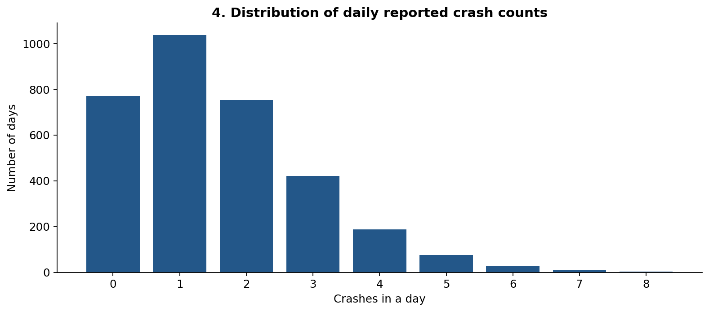
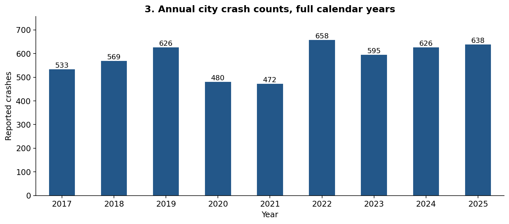

# Charlottesville Crash and Weather Dataset


## Overview

This dataset combines **reported motor vehicle crashes inside the City of Charlottesville, Virginia**, with historical weather near Charlottesville. It is designed for a time-based data science project. It contains real downloaded records, not simulated observations. 

The crash records come from Virginia DMV's Traffic Records Electronic Data System (TREDS), published by VDOT through the Virginia Roads public API [1], [4]. Weather comes from Open-Meteo's Historical Weather API using the ERA5 model [3]. Calendar and lag features are calculated from those records.

**Suggested research question:** Do recent crash counts, seasonality, and earlier weather conditions improve forecasts of the number of reported crashes in Charlottesville on the next day?

The outcome is the **number of reported crashes**, not medical emergencies, all 911 calls, or the chance that a particular person will have an accident. Historical local EMS records have not been included.

## Geographic and time coverage

- Geography: **City of Charlottesville only**. Records were selected using `PHYSICAL_JURIS = '104'`. The API's jurisdiction codebook labels 104 as the City of Charlottesville [2]. This excludes crashes assigned to Albemarle County, including locations with Charlottesville mailing addresses outside city limits.
- Incident file: **5,432 unique crashes**, January 1, 2017–July 31, 2026.
- Main daily table: **3,287 consecutive days**, January 1, 2017–December 31, 2025, representing **5,197 crashes**.
- The remaining **235 crashes in 2026** are retained in the incident file and flagged as a partial year. They are excluded from the main daily table.
- Weather file: **3,530 days**, December 1, 2016–July 31, 2026. The earlier weather dates supply lagged features at the beginning of 2017.
- Weather was requested at latitude 38.03, longitude −78.48. The actual ERA5 grid coordinates, units, and elevation are recorded in `quality_report.json`. This is regional gridded weather, not a measurement at each crash location [3].

The dates above describe this frozen download. The script uses fixed date ranges for reproducibility; refreshing the API does not automatically extend the modeling period.

## Files

| File | Contents and purpose |
| --- | --- |
| `cville_daily_crashes_weather.csv` | Main dataset: one row per city calendar day, with crash counts, weather, calendar variables, and lagged features. |
| `cville_crash_incidents.csv` | One row per crash, including date/time, location, severity, injuries, and collision type. |
| `cville_weather_daily.csv` | Weather observations from the historical ERA5 reanalysis API, before joining to daily crashes. |
| `annual_crash_counts.csv` | Annual counts and a partial-year flag for 2026. |
| `source_codebook.csv` | Original coded-value definitions downloaded from the crash API metadata. |
| `quality_report.json` | Record counts, missingness, date ranges, duplicate checks, and weather match results. |
| `provenance.json` | API filter, retrieval information, weather request, and SHA-256 hashes of the source files. |
| `raw/` | Frozen source JSON responses and metadata used to reproduce the dataset. |

## Exploratory figures used in MI2

These are copies of the original EDA notebook figures, included here so the README and MI2 findings can be read together. The analysis uses the full 2017–2025 study period. Original generated figures remain in `Output/`; these documentation copies are in `Data/`.

### Figure 1. Distribution of daily reported crash counts



The dataset includes 771 zero-record days (23.5%). Daily counts average 1.58 crashes, with variance 1.89 and a maximum of 8. A zero means no crash record appears for that day in this source. The original image retains its notebook label, plot 4; it is Figure 1 in MI2.

### Figure 2. Annual reported crash counts



Recorded counts decline to 480 in 2020 and 472 in 2021, then rise to 658 in 2022. The plot does not establish whether changes reflect travel, reporting, or other factors. This motivates evaluation by year and a sensitivity analysis excluding 2020–2021. The original image retains its notebook label, plot 3; it is Figure 2 in MI2.
## Sources and compilation

### Crash records

The public `CrashData_Basic` layer provides reportable crash locations and related attributes [1], [2]. DMV owns and maintains the source records; VDOT publishes the public dataset [1], [4]. The city-filtered API reported 5,432 records. They were downloaded in six pages of at most 1,000 records, sorted by `OBJECTID`, rather than accepting a truncated API result.

The frozen download contains no duplicate `DOCUMENT_NBR` identifiers and no missing crash identifiers or dates. `DOCUMENT_NBR` becomes `crash_id`, stored as text. The script checks duplicates and retains the lowest `OBJECTID` if a future refresh introduces repeated identifiers, logging exclusions and conflicting values. No records were excluded from this version.

### Weather records

Open-Meteo was queried with `models=era5` to keep the requested weather model consistent across the study period [3]. Daily maximum, minimum, and mean temperature; precipitation; snowfall; and maximum wind speed were retrieved. Open-Meteo weather reanalysis combines observations with modeled estimates; it should not be described as a direct local weather-station dataset [3].

Weather is joined to the crash-count table by the **America/New_York calendar date**. Every day in the main daily table matched a weather date. The quality report separately records any missing weather values.

### Time processing and feature creation

1. Select city records using the jurisdiction field, not a geographic bounding box.
2. Check the source count, crash IDs, dates, and duplicates.
3. Convert the `CRASH_DT` epoch-millisecond value to its Eastern calendar date. In this download, dates are encoded as Eastern midnight, appearing as 04:00 or 05:00 UTC depending on daylight saving time.
4. Read the actual crash clock time from the separate `CRASH_MILITARY_TM` field. For example, `927` becomes `09:27`. The date field's midnight is **not** the crash time. Invalid or missing clock times would remain blank; none were found in this download. A recorded `0000` is preserved as midnight, although a source default cannot be independently ruled out.
5. Translate category codes using the original metadata domains [2]. Preserve both codes and labels. Unknown mappings remain blank rather than receiving invented meanings.
6. Aggregate unique crashes by Eastern calendar date. Add every date in 2017–2025; dates without a record receive a count of zero.
7. Join daily ERA5 weather by date.
8. Calculate calendar variables, 1-, 7-, and 14-day count lags, trailing 7- and 28-day means, and weather values from seven days earlier. All trailing count features exclude the target day.
9. Leave early count lags blank when a complete preceding window is unavailable. Do not replace these blanks with zero.

The zero-count rule means **no crash record exists for that day in the downloaded source**. It does not independently establish that no crash occurred or that reporting was complete.

## Data dictionary

### Main daily dataset

| Column(s) | Meaning / units |
| --- | --- |
| `date_local` | Target calendar date in America/New_York, formatted YYYY-MM-DD. Unique row key. |
| `year`, `month`, `day_of_month`, `day_of_year` | Calendar components of the target day. |
| `weekday_mon0` | Monday = 0 through Sunday = 6. |
| `is_weekend` | 1 for Saturday/Sunday; otherwise 0. |
| `month_sin`, `month_cos` | Cyclic month features: sine/cosine of `2π × (month − 1) / 12`. |
| `crash_count` | Number of unique reported city crashes on the target day. Primary forecasting outcome. |
| `injury_crash_count` | Crashes with at least one recorded injured person. |
| `fatal_crash_count` | Crashes with at least one recorded death. |
| `persons_injured`, `persons_killed` | Total people recorded as injured/killed in that day's crashes. These are people, not crash counts. |
| `crash_count_lag1`, `crash_count_lag7`, `crash_count_lag14` | Crash count 1, 7, or 14 days before the target date. |
| `crash_count_prior7_mean`, `crash_count_prior28_mean` | Mean daily crash count over the preceding 7 or 28 days, excluding the target date. |
| `observed_temp_max_c`, `observed_temp_min_c`, `observed_temp_mean_c` | Target-day historical maximum/minimum/mean temperature, °C. Descriptive variables. |
| `observed_precip_mm` | Target-day total precipitation, mm. |
| `observed_snowfall_cm` | Target-day snowfall, cm. |
| `observed_wind_max_kmh` | Target-day maximum wind speed at 10 m, km/h. |
| `temp_max_c_lag7`, `temp_min_c_lag7`, `temp_mean_c_lag7` | Corresponding temperature values seven days before the target date. |
| `precip_mm_lag7`, `snowfall_cm_lag7`, `wind_max_kmh_lag7` | Corresponding precipitation, snowfall, and wind values seven days before the target date. |
| `coverage_status` | Full calendar-year date range; source reporting completeness is unverified. |
| `source_ref` | Numbered references identifying the contributing sources. |

### Incident dataset

| Column(s) | Meaning |
| --- | --- |
| `crash_id`, `source_object_id` | Crash document identifier and API row identifier. |
| `date_local`, `time_local_hhmm`, `time_raw_hhmm`, `hour_local` | Eastern date, formatted crash time, original HHMM value, and hour. A full UTC crash timestamp is not inferred. |
| `year`, `month`, `weekday_mon0`, `is_weekend` | Derived calendar features. |
| `physical_jurisdiction_code`, `physical_jurisdiction` | City filter code and its verified label. |
| `latitude`, `longitude`, `street_source` | Source-reported coordinates and road/location text. Coordinates are in decimal degrees. |
| `severity_code`, `severity_label` | Original crash severity code and its metadata label. |
| `persons_killed`, `persons_injured`, `vehicles_involved` | Recorded counts of people killed, people injured, and vehicles. |
| `pedestrians_killed`, `pedestrians_injured` | Recorded pedestrian casualties. |
| `collision_type_code`, `collision_type_label` | Original collision category and decoded label. |
| `reported_weather_code`, `reported_weather_label` | Weather category in the crash report, distinct from ERA5 weather. |
| `road_surface_code`, `road_surface_label` | Original road-surface condition and label. |
| `light_condition_code`, `light_condition_label` | Original lighting condition and label. |
| `record_period_status` | Full calendar-year range or partial 2026. This is a date-range flag, not a completeness certification. |
| `source_ref` | Crash dataset and metadata references. |

The standalone weather file uses `date_local`, `temp_max_c`, `temp_min_c`, `temp_mean_c`, `precip_mm`, `snowfall_cm`, `wind_max_kmh`, and `source_ref`. Its units match the corresponding daily-table fields. CSV blanks indicate missing/unavailable values; zero is an actual numeric value.

## Forecasting use

Treat a row's `date_local` as the day being predicted. For a retrospective one-day-ahead experiment, use calendar variables, the count lags/trailing means, and the weather columns ending in `_lag7` as candidate predictors. The seven-day weather lag is deliberately longer than ERA5's documented approximately five-day publication delay [3]. Reanalysis can still be revised, so these are not authenticated historical forecast vintages.

**Do not use the target day's `observed_*` weather, injury/fatality counts, or incident severity as advance predictors.** Those columns describe outcomes or weather already observed. Real future-weather predictors would require archived forecasts available at the prediction time, not target-day realized weather.

Suggested comparisons:

- Same-weekday baseline: yesterday's corresponding weekday count from seven days earlier.
- Calendar-only Poisson regression.
- Calendar + lagged counts model.
- Calendar + lagged counts + lagged weather model.

Use chronological splits: **2017–2022 training, 2023 validation, and 2024–2025 final test**. Drop rows with missing required lag features rather than imputing them as zero. Compare daily MAE and Poisson deviance. Fit any imputation, scaling, and hyperparameter selection using training data only.

A rolling one-day-ahead evaluation may use the preceding test day's observed count to predict the next day, provided that assumption is stated. A forecast of an entire future week issued at once cannot use actual counts from within that week. Reporting timestamps are unavailable here, so even lagged crash counts are retrospective rather than proven available in real time.

## Limitations

- This includes reported motor vehicle crashes, not all accidents or emergency calls. It contains no medical diagnoses or EMS demand history.
- The city and county are different jurisdictions; this dataset intentionally covers the city only.
- VDOT states that records may contain omissions, and recent records are preliminary [1]. Full calendar years do not guarantee complete reporting.
- Crashes that do not enter the reporting system are absent. Zero-record days are therefore source-specific counts.
- 2026 is partial and is not comparable with full-year totals. The COVID-era period may also have different travel patterns; consider a sensitivity analysis excluding 2020–2021.
- Weather is a regional ERA5 grid estimate and cannot capture every street-level condition [3].
- Counts of crashes alone do not estimate risk per trip or per mile; no traffic-exposure measure is included.
- The weather join supports association and retrospective forecasting experiments, not causal claims about weather.
- The full source files are retained for reproducibility. Public street/location fields should be treated as record attributes, not as information about identified people.

## Reproduce the dataset

Open the Scripts folder and run "build_dataset.py".

This rebuilds the CSV and quality files from the included source snapshots without downloading new data. It requires Python 3.9 or newer with America/New_York timezone data; no third-party Python packages are required.

To download current source records and rebuild:

```bash
python3 build_dataset.py --refresh
```

Refresh uses the same city filter, model, and fixed modeling dates. The incident file can change as the provider revises its records. It verifies pagination and the API count and records any duplicate conflicts or missing values. Preserve the original package if you need the exact October 9, 2026 version.

## References

[1] Virginia Department of Transportation, “Full_Crash,” Virginia Roads, ArcGIS REST Services Directory. Accessed: Oct. 9, 2026. [Online]. Available: https://services.arcgis.com/p5v98VHDX9Atv3l7/arcgis/rest/services/Full_Crash/FeatureServer

[2] Virginia Department of Transportation, “CrashData_Basic (ID: 0),” Full_Crash, ArcGIS REST Services Directory. Accessed: Oct. 9, 2026. [Online]. Available: https://services.arcgis.com/p5v98VHDX9Atv3l7/arcgis/rest/services/Full_Crash/FeatureServer/0

[3] Open-Meteo, “Historical Weather API.” Accessed: Oct. 9, 2026. [Online]. Available: https://open-meteo.com/en/docs/historical-weather-api

[4] Virginia Department of Motor Vehicles, “Statewide Crash Data.” Accessed: Oct. 9, 2026. [Online]. Available: https://www.dmv.virginia.gov/safety/crash-data

Weather attribution: Open-Meteo Historical Weather API, ERA5 reanalysis. Source/API terms and attribution requirements continue to apply to redistributed source data [1], [3].
