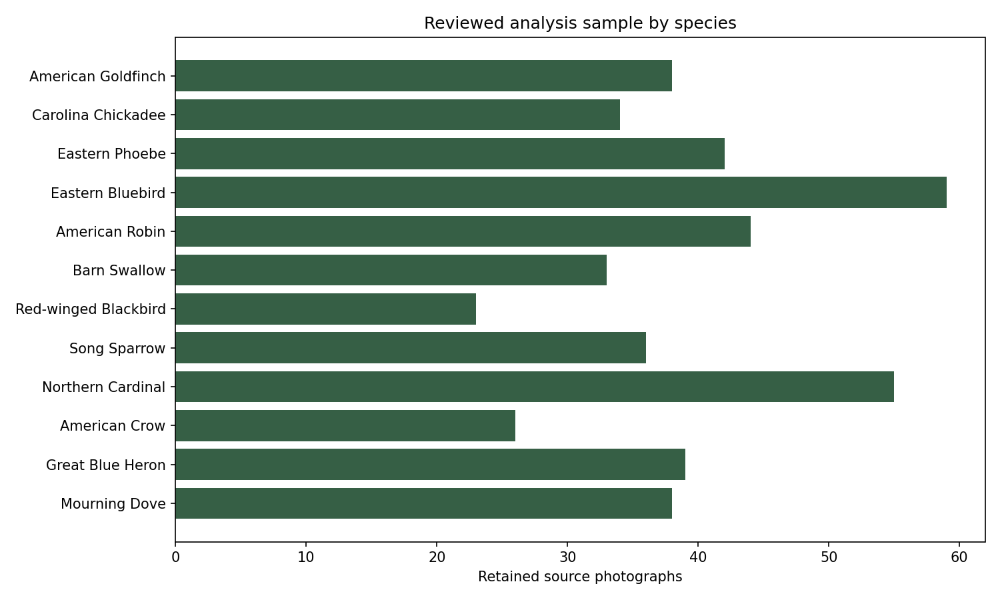
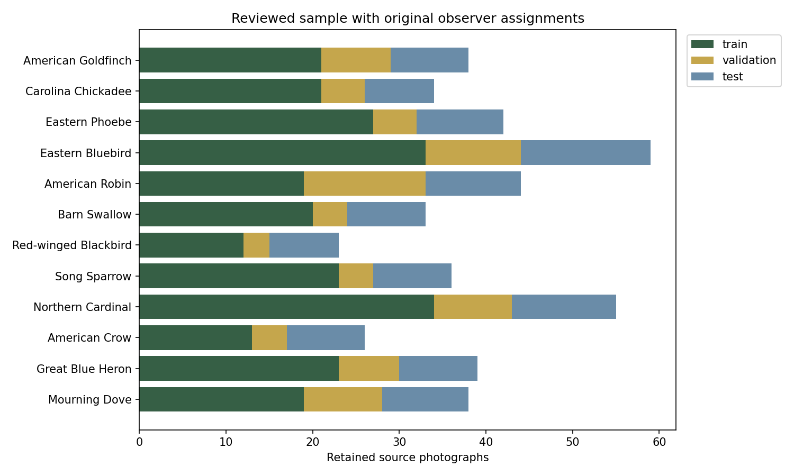

# Bird Identification Data

## Summary and final analysis inputs

The original November 5 collection contains **482 images, 12 species, and 60 observers**. Its medium-resolution photographs and manifest remain unchanged. Visual quality screening on November 16 retained **467 images from 56 observers**, with **265 train / 83 validation / 119 test** images. Every species remains in every split, with no observer crossing partitions. The target remains identification of the 12 selected species, with an 80% held-out accuracy goal. The training-majority baseline is now complete; no ResNet-18 classifier has been trained or scored.

Use **bird_images_analysis.csv**, **class_mapping.json**, **dataset_freeze.json**, and the photographs referenced under **images/** for the next analysis. Keep bird_images.csv as the original manifest. All image paths are relative to Project_3. Review is amateur screening, not expert taxonomic verification; see [review_policy.md](review_policy.md).

## Provenance and permissions

Source: public iNaturalist API [2]. Area: Virginia (place ID 7) intersected with latitude 36.54–37.95 and longitude −83.68–−79.65, an operational Southwest Virginia area rather than an official county list. The collector considered up to the latest 200 matching research-grade, non-captive observations per species, required eligible licensed photos, and excluded obscured/private candidates. One eligible photo per observation was chosen, capped at 60 per species and eight per observer/species, using seeded observer round-robin selection. Observation-date cutoff: November 5, 2026. Reported source dates span May 6, 2010 through October 21, 2026. Of 484 download attempts, 482 succeeded; none was removed by the original byte-hash check. Raw cached records preserve the source response used for collection. API pacing follows [4].

Each photo retains its recorded CC0, CC BY, or CC BY-SA permission, credit, and source links [3]. Follow its actual source terms; the code's MIT license does not replace photo or raw-metadata permissions. The manifest has no precise coordinate columns, but locality text need not be county-only and cached API responses may contain more detailed public metadata. This setup did not sanitize or remove source metadata. Do not infer private locations or redistribute sensitive details unnecessarily.

Research-grade is community identification [5], not an expert guarantee. Convenience sampling reflects observers and detection effort, not abundance or seasonal bird population changes. Performance will apply only to these selected classes and sampled conditions. IDs, names, locality, credit strings, and split labels are not image-model predictors. Difficult bird photographs were not excluded based on model performance.

## Files

| File/folder | Purpose |
|---|---|
| bird_images.csv | Original 482-image source manifest; retained unchanged. |
| bird_images_analysis.csv | Reviewed 467-image modeling manifest, same columns and original assignments. |
| images/ | Original source JPEGs; excluded images remain for provenance. |
| download_manifest.csv | All 484 original selected attempts and their status. |
| selected_species.csv | Original per-species availability and selection counts. |
| quality_review.csv | Original review log, preserved unchanged. |
| quality_review_analysis.csv | 482 Visual review decisions with reasons, reviewer, and review date. |
| review_policy.md | Selection rules, review scope, limitations, and provenance. |
| class_mapping.json | Twelve records with class_index (0–11), taxon_id, scientific_name, common_name; indices follow ascending numeric taxon ID. |
| dataset_freeze.json | SHA-256 of original manifest, review inputs, final manifest, and class mapping; individual image hashes remain in manifests. |
| raw/ | Cached observation JSON responses, species-count response, earlier pilot records, and original quality_review_before_setup.csv. |

## Manifest dictionary

The original and analysis manifests have identical column definitions. IDs are strings, not quantitative features. Blank metadata mean unavailable, not zero. Date/location information can be missing without preventing image loading. Species-label uncertainty remains unquantified.

| Field | Definition |
|---|---|
| `observation_id` | Public observation key; one retained photo per observation. |
| `photo_id` | Public photo key, unique; string returned with each tensor. |
| `taxon_id` | Species target key; mapped to a class index using class_mapping.json. |
| `scientific_name` | Source species name; not independently expert-verified. |
| `common_name` | Source display name; descriptive label. |
| `observed_on` | Reported observation date (YYYY-MM-DD); not retrieval date. |
| `month` | Derived observation month, 1–12; blank if unavailable. |
| `observer_id` | Public contributor key used for split isolation, not a feature. |
| `place_guess` | Source locality text; not guaranteed county-only; no coordinate columns in the manifest. |
| `quality_grade` | Source research-grade status, not a guarantee of correct labels. |
| `photo_license` | Source permission code: cc0, cc-by, or cc-by-sa. |
| `license_url` | Recorded reference link for the photo permission; verify source terms before reuse. |
| `attribution` | Original photographer credit. |
| `observation_url` | Source observation page. |
| `photo_url` | Source photo page. |
| `image_url` | Medium-size image download URL. |
| `image_path` | Path relative to Project_3, used only to read pixels. |
| `width` | Decoded image width in pixels. |
| `height` | Decoded image height in pixels. |
| `sha256` | SHA-256 of source image bytes; preserved after review. |
| `download_status` | ok for usable source/analysis manifest rows. |
| `split` | Unchanged train, validation, or test assignment; never a predictor. |

The analysis review log has photo_id, observation_id, common_name, image_path, review_status, decision, reason, reviewer, and reviewed_on. decision is retain or exclude. class_mapping.json uses a classes array under schema_version and ordering metadata; use class_index, not row positions from alphabetical common names.

| Index | Taxon ID | Species |
|---|---|---|
| 0 | 3454 | Mourning Dove |
| 1 | 4956 | Great Blue Heron |
| 2 | 8021 | American Crow |
| 3 | 9083 | Northern Cardinal |
| 4 | 9100 | Song Sparrow |
| 5 | 9744 | Red-winged Blackbird |
| 6 | 11901 | Barn Swallow |
| 7 | 12727 | American Robin |
| 8 | 12942 | Eastern Bluebird |
| 9 | 17008 | Eastern Phoebe |
| 10 | 144814 | Carolina Chickadee |
| 11 | 145310 | American Goldfinch |

## Recreate preparation and verify loading

From Project_3 after installing Scripts/requirements.txt:

```bash
python Scripts/02_prepare_data.py
python Scripts/03_check_loader.py
python Scripts/test_data_setup.py
python Scripts/04_majority_baseline.py
```

Preparation applies the saved decisions and recreates the final manifest, mapping, freeze, exclusion report, split counts, and two updated plots. It does not re-review photographs or change source files. The original build_dataset.py is for source collection and can recover failed downloads or change the sample; do not rerun it over this frozen collection for routine modeling. Keep a separate version for any recollection.

The original Scripts/01_bird_eda.ipynb describes the original 482-image establishment sample. Its existing numbered figures and eda_summary.json remain historical. New analysis_* outputs and preparation_report.json describe the reviewed sample. Do not mix their counts when reporting final results.

## Explanatory plots and findings



Retained counts remain unequal; overall accuracy should be accompanied by per-species recall and test support.



All 12 classes remain represented, with observers still isolated. This does not rule out site-level dependence or every near duplicate.

Preparation excluded 15 noneligible images; none of the six fingerprint candidates was confirmed as a duplicate. The review cannot establish expert species correctness. The source labels remain unchanged. See Output/analysis_exclusions.csv and review_policy.md for exact decisions.

## References

Numbers refer to [the project's IEEE reference list](../REFERENCES.md). Photo-level credits and original links remain in both image manifests.
