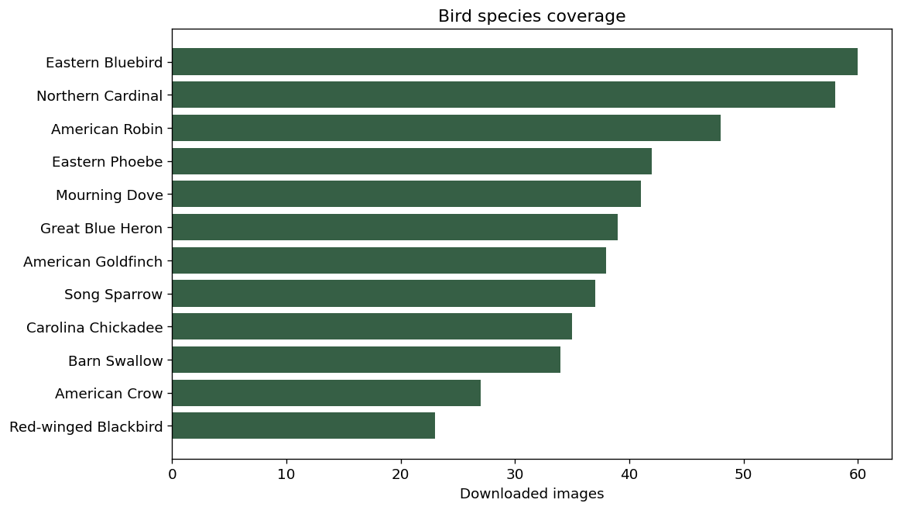
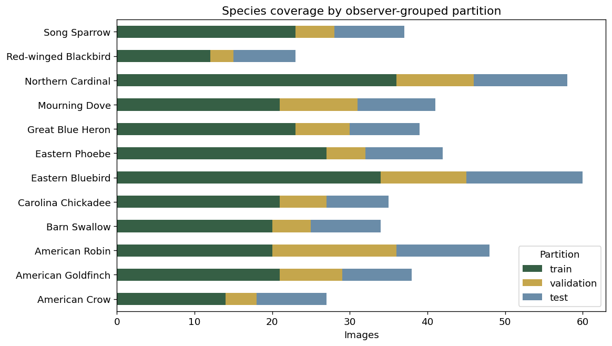
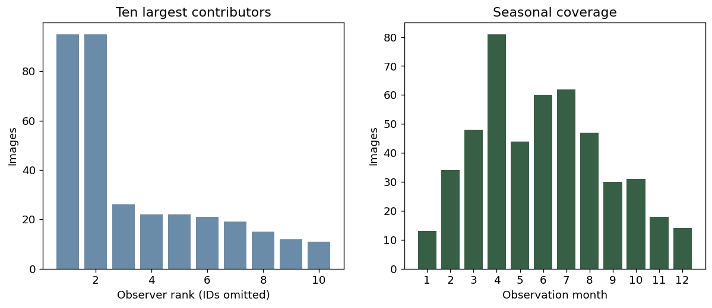

# Data

This folder contains the initial source records, downloaded images, final analysis manifest, and metadata for the Virginia plant-image project. The final data for proposed image modeling are **plant_images.csv plus the image files it points to**. The EDA tables in Output summarize these inputs and do not replace them.

## Files in this folder

| File or folder | Contents and purpose |
|---|---|
| `README.md` | Data documentation, file inventory, recreation instructions, and links to exploratory plots. |
| `plant_images.csv` | Final image-level analysis table: 320 photographs with species labels, image paths, source credits, dimensions, hashes, and proposed train/validation/test assignments. Use this table with `images/` for image modeling. |
| `images/<taxon_id>/<photo_id>.jpg` | The 320 downloaded photographs, organized into eight species folders. The `image_path` field in `plant_images.csv` locates each photograph from the project root. |
| `download_manifest.csv` | Audit of all selected download attempts, including status and metadata. It currently matches the final retained sample because no downloads failed and no exact byte duplicates were removed. |
| `selected_species.csv` | Candidate availability and selected counts for the eight chosen species. |
| `species_availability.csv` | First 100 results of the broader Virginia plant species-count query; not a complete inventory. |
| `species_reference.csv` | Species names, paired/unpaired comparison groups, food-use context, cautions, and source keys. |
| `nutrition_reference.csv` | One nutrition-coverage record per species, including explicit missing/not-applicable statuses. |
| `nutrient_values.csv` | Seven published purslane nutrient values with units, plant-part/preparation context, and source details. These are reference values, not measurements of photographed specimens. |
| `sources.csv` | Source identifiers, organizations, titles, URLs, and access dates for the reference tables. |
| `taxa.json` | Resolved scientific names and iNaturalist species identifiers for the eight selected taxa. |
| `quality_review.csv` | Human review log initialized by the EDA notebook. Review is pending; the notebook preserves existing entries on reruns. |
| `raw/` | Initial API responses and the nutrition evidence record used to assemble and document the dataset. |

### Raw source files

The `raw/` folder contains the following 18 files:

- `species_counts.json`: original response for the broader Virginia plant availability query.
- `nutrition_evidence.json`: publication, table, and numerical evidence for the compiled purslane nutrition values.
- Eight `observations_<taxon_id>_200.json` files: candidate observation responses for taxon IDs **48599, 52998, 54795, 55745, 58893, 58991, 76610, and 84300**.
- Eight taxonomy-resolution responses: `taxon_Daucus_carota.json`, `taxon_Conium_maculatum.json`, `taxon_Sambucus_canadensis.json`, `taxon_Phytolacca_americana.json`, `taxon_Portulaca_oleracea.json`, `taxon_Euphorbia_maculata.json`, `taxon_Sassafras_albidum.json`, and `taxon_Trifolium_repens.json`.

## Where to find and run the scripts

The code is in the sibling [Scripts folder](../Scripts/README.md). Run these commands from the **project root**, the folder containing `Data`, `Scripts`, and `Output`:

```bash
python -m pip install -r Scripts/requirements.txt
python Scripts/build_dataset.py
jupyter lab Scripts/01_plant_eda.ipynb
```

[build_dataset.py](../Scripts/build_dataset.py) rebuilds `plant_images.csv`, `download_manifest.csv`, `selected_species.csv`, `species_availability.csv`, and `Output/build_summary.json` from cached source responses and images. It reuses existing files and downloads missing source records or photographs when necessary. Rebuilding the supplied snapshot uses the included cached files; obtaining missing records requires internet access. Keep `raw/` to retain the original snapshot.

[01_plant_eda.ipynb](../Scripts/01_plant_eda.ipynb) contains the commented exploratory analysis. Open it and run all cells in order to recreate the EDA tables and figures in `Output/`. It also creates `Data/quality_review.csv` if that file is missing. Human review decisions, `taxa.json`, and the curated species/nutrition/source reference tables are included inputs; the collection script does not recreate or independently verify those compilations.

## Where generated outputs are saved

Generated figures, summary tables, and audit reports belong in the sibling [Output folder](../Output/README.md). They summarize this folder's data. The final image manifest and photographs remain here in `Data/`; there is no need to duplicate the generated EDA tables here.

| Output file | Contents |
|---|---|
| `01_species_counts.png` | Image counts for each species. |
| `02_split_coverage.png` | Species counts in the proposed train, validation, and test partitions. |
| `03_observers_and_months.png` | Observer concentration and observation-month coverage. |
| `04_image_dimensions.png` | Image dimensions and aspect ratios. |
| `05_example_images.png` | One source-labeled example per species; photo IDs link to credits in the image manifest. |
| `06_lookalike_groups.png` | Coverage of paired and unpaired species research groups. |
| `build_summary.json` | Collection filters, snapshot time, counts, download/deduplication results, and partition sizes. |
| `eda_summary.json` | EDA counts and checks; explicitly records pending human review and absence of a fitted model. |
| `species_summary.csv` | Species-level sample and observer counts. |
| `species_split_counts.csv` | Species counts by partition. |
| `observer_counts.csv` | Number of retained images per observer. |
| `month_counts.csv` | Number of images by observation month. |
| `missing_values.csv` | Missing-value counts and percentages for manifest fields. |
| `image_integrity.csv` | Image-file integrity audit. |
| `pixel_duplicate_candidates.csv` | Candidates sharing the notebook's resized-pixel hash; not a comprehensive near-duplicate test. |
| `lookalike_group_counts.csv` | Image counts by comparison group and reference grouping. |
| `nutrition_coverage.csv` | Summary of compiled nutrition information and its availability. |
| `README.md` | Output-folder orientation. |

## Data summary and access

The included snapshot has **320 images**, **eight species**, **40 images per species**, and **181 distinct observers**. Study area: all Virginia, not specifically Southwest Virginia. Observations span 2012-09-01 to 2026-11-01; the observation-date cutoff is November 5, 2026. The photographs are medium-sized JPEG downloads with original source credits and proposed observer-separated split labels. All project data fit in this ZIP and may be accessed locally after extraction. No account or API key is required.

| Taxon ID | Scientific name | Display name | Comparison group |
|---|---|---|---|
| 76610 | Daucus carota | Wild carrot | carrot_hemlock |
| 52998 | Conium maculatum | Poison hemlock | carrot_hemlock |
| 84300 | Sambucus canadensis | American elderberry | elderberry_pokeweed |
| 48599 | Phytolacca americana | American pokeweed | elderberry_pokeweed |
| 58991 | Portulaca oleracea | Common purslane | purslane_spurge |
| 58893 | Euphorbia maculata | Spotted spurge | purslane_spurge |
| 54795 | Sassafras albidum | Sassafras | unpaired |
| 55745 | Trifolium repens | White clover | unpaired |

Mushrooms are not included. The dataset includes ordinary unpaired plants as well as selected lookalike comparisons. Class balance was constructed by sampling; it does not estimate natural abundance or how often a plant will appear in practice.

## Provenance and selection

Photographs and source community identifications were obtained through the public iNaturalist API [1], with paced requests following recommended practices [2]. Filters request research-grade, non-captive Virginia observations with photos licensed CC0, CC BY, or CC BY-SA and observed on or before November 5, 2026. Exact species IDs were resolved and checked against the candidate observations. Obscured/private observations were excluded from the final selection. Initial API snapshots are retained in raw/. These raw responses may contain extra public metadata supplied by the source; selected analysis tables do not include coordinate columns.

For each species, the collector considered the latest 200 filtered observations (ordered by observation ID), retained the first eligible licensed photo per observation, then selected up to 40 images using seeded round-robin observer sampling, capped at five images per observer per species. This is a convenience sample rather than a random sample of Virginia vegetation. Images were decoded and byte-hash deduplicated. A seeded search of 5,000 observer assignments selected splits close to 60/20/20 percent while encouraging class coverage; only metadata, never prediction performance, was used. Current sizes: train 189, validation 62, test 69. Every observer belongs to only one split, including across species.

University extension publications support the separately compiled species cautions and lookalike comparisons [3]–[10], [13], [14]. Numeric nutrition is available only for a published purslane reference: seven values per 100 g raw plant material from UF/IFAS Table 2 [11]. Nutrition is not estimated from a photograph or generalized to other species, parts, or preparations. Cultivated-carrot nutrition was not substituted for wild carrot. See sources.csv, nutrient_values.csv, and raw/nutrition_evidence.json for the evidence trail.

## License and permissions

There is no single license for all content. Each photograph retains the photo_license, license_url, attribution, and source links in plant_images.csv. CC0 waives copyright to the extent legally possible; CC BY requires attribution and license/change notices; CC BY-SA adds share-alike requirements for adaptations. Preserve credits and source links when using or displaying photographs. Source license claims were recorded at retrieval and can later change. Do not label the image collection as MIT-licensed.

Reference material retains its publisher’s terms. This package contains brief paraphrased context and numerical facts with citations, not complete third-party publications. The UF/IFAS publication identifies a CC BY-NC-ND license; consult that source before redistributing its text or tables. API snapshots are retained as provenance; individual observation text and photos may have different permissions. No permission is inferred merely from public accessibility.

## Ethical statements and intended use

This is an educational species-identification dataset, not a validated foraging or food-safety system. A food_associated reference label is not equivalent to edible in all circumstances. True toxic-comparator images predicted as food-associated species must be examined separately from overall accuracy. No preparation instructions, medical claims, or nutrient estimates from pixels are provided. Do not use a model trained on this starter to decide whether to eat a plant. Respect observer privacy and avoid inferring sensitive locations from public metadata.

## Data dictionary

### Final image manifest and download audit

plant_images.csv has one row per retained image. download_manifest.csv has the same fields for selected/download-attempted images, including failures if present; it can retain records excluded from the final manifest. The current build has 0 download failures and 0 exact byte duplicates removed.

| Feature | Meaning, units, and uncertainty |
|---|---|
| `observation_id` | iNaturalist observation identifier; one retained photo per observation. |
| `photo_id` | iNaturalist photo identifier; unique in the final table. |
| `taxon_id` | Source species identifier and intended classifier target; categorical, not numeric magnitude. |
| `scientific_name` | Source scientific name, not independently expert-verified here. |
| `common_name` | Source common name; may differ from display_common_name in the reference table. |
| `observed_on` | Source observation date (YYYY-MM-DD); not download date. |
| `month` | Month extracted from observed_on, 01–12; blank if unavailable. |
| `observer_id` | Public observer identifier, used to keep all one observer’s images in one partition. |
| `place_guess` | Public source locality text; imprecise and not a verified coordinate. |
| `quality_grade` | Source research-grade status at retrieval; community identification is not a guarantee. |
| `photo_license` | Photo permission code: cc0, cc-by, or cc-by-sa. |
| `license_url` | Canonical permission URL corresponding to photo_license. |
| `attribution` | Photo credit copied from the source; retain when redistributing or displaying images. |
| `observation_url` | Public page for the original observation. |
| `photo_url` | Public page for the selected photograph. |
| `image_url` | Medium-size image download URL, rather than the original full-resolution image. |
| `image_path` | Path to downloaded image relative to project root. |
| `width` | Decoded downloaded-image width, pixels. |
| `height` | Decoded downloaded-image height, pixels. |
| `sha256` | SHA-256 digest of image bytes; used for exact deduplication. |
| `download_status` | ok for final retained images; error type for failed attempts in download_manifest.csv. |
| `split` | Proposed train, validation, or test partition; observer-separated and assigned using metadata only. |

### Other table dictionaries

| File | Fields and meaning |
|---|---|
| `selected_species.csv` | taxon_id: species ID; common_name: source label; api_matching_observations: full API result count at retrieval; eligible_in_latest_200: usable candidates in the latest 200 returned observations; selected: records chosen before download/deduplication. |
| `species_availability.csv` | taxon_id, scientific_name, common_name, rank: source taxonomy; matching_observations: filtered observation count. This is only the first 100 API species-count results for all Virginia plants, not a complete inventory or the eight-species sampling frame. |
| `species_reference.csv` | taxon_id: unique join key; scientific_name/display_common_name: reference labels; lookalike_group: comparison name or unpaired (no paired comparator selected); reference_group: food_associated or toxic_comparator research grouping; food_context: documented use context; caution: limitations/toxicity summary; source_ids: semicolon-separated keys to sources.csv; reviewed_on: compilation date. A food_associated species may also have toxic parts. |
| `nutrition_reference.csv` | taxon_id/scientific_name: one row per species; plant_part/preparation: context matched or explicit not_matched/not_applicable; nutrition_status: published_reference_value, qualitative_only, not_matched, or not_applicable_toxic_comparator; nutrient/value/unit/basis: representative compiled numeric fact if available; nutrition_notes: evidence limits; source_ids: source keys. Blank numeric values mean no value compiled, not zero. |
| `nutrient_values.csv` | Long-format numerical reference: taxon_id/scientific_name, plant_part, preparation, nutrient, value, unit, basis_g (100 grams), source_id/source_table/source_url, and caution. Seven purslane reference values; not measurements of the photographed plants. |
| `sources.csv` | source_id: unique reference key; organization, title, url: source identity and location; accessed: access date. |
| `quality_review.csv` | photo_id/observation_id/common_name/image_path: image keys; review_status: pending until reviewed; decision: reviewer-entered retain/exclude; reason: reviewer rationale. This starter does not apply exclusions automatically. |
| `taxa.json` | Selected taxon_id, scientific_name, common_name resolved from exact species names. |
| `raw/*.json` | Original source responses for taxonomy, candidate observations, and API species counts; nutrition_evidence.json records compiled numerical evidence and its publication/table, not a full source download. These are initial audit inputs, not model features. |

All IDs are categorical strings. Missing strings may load as NaN in pandas. A missing observation date is parsed as NaT in EDA. No uncertainty intervals accompany the source labels, image dimensions, or reference nutrients; community-label error and source variability remain unknown.

## Exploratory questions answered

**Are the selected species balanced?** Yes. Each has 40 images, so a class-uniform guess has expected accuracy 12.5% on the full balanced sample. Each individual split can be slightly imbalanced; a training-majority baseline must be calculated from the training labels and evaluated on the test labels.

**Do the proposed partitions reuse photographers?** No. The notebook checks that every observer appears in exactly one split; every species is represented in each split. These checks reduce one source of leakage but do not establish independence of nearby observations or visually similar photographs.

**How complete is the nutrition lookup?** One of eight species has compiled numeric values (purslane), one has qualitative-only information (elderberry), and other records explicitly mark unavailable/not-applicable values. Absence of a number is not a nutrient value of zero.

## Explanatory plots

These are generated by Scripts/01_plant_eda.ipynb and stored once in Output. Relative links display them here without duplicating the image files.



Equal counts reflect the 40-per-species sampling design, not prevalence in Virginia.



This checks class coverage under the observer-separated assignment; target proportions are approximate.



This reveals photographer concentration and seasonal imbalance in the convenience sample.


Unpaired sassafras and white clover are included without requiring a selected toxic counterpart.

## Current unknowns and next actions

Human quality review is **pending**, as recorded in quality_review.csv. Community research-grade labels are not independent expert verification. Before modeling, review diagnostic visibility, multiple species, mislabeled subjects, and near duplicates across splits; document exclusions and freeze a revised manifest if necessary. The notebook verifies decoding and hashes and audits resized-pixel duplicates, but does not complete a comprehensive near-duplicate or botanical review.

A small convenience sample of 40 images per class is a starter, with limited test precision. Future steps should expand observers, seasons, and geography, check class-specific errors, and report uncertainty around held-out accuracy. This closed eight-species task says nothing about identification of species absent from training. Proposed model settings remain tentative, as stated in MI1; no model performance is reported in this package.

## Rebuilding and references

Scripts/build_dataset.py can reproduce the final image table from the included raw records and cached images. Scripts/01_plant_eda.ipynb recreates EDA outputs and initializes the pending review log. Existing review decisions are preserved. Consult the root README for exact commands and [REFERENCES.md](../REFERENCES.md) for all IEEE sources; reference numbers above refer to that file.
